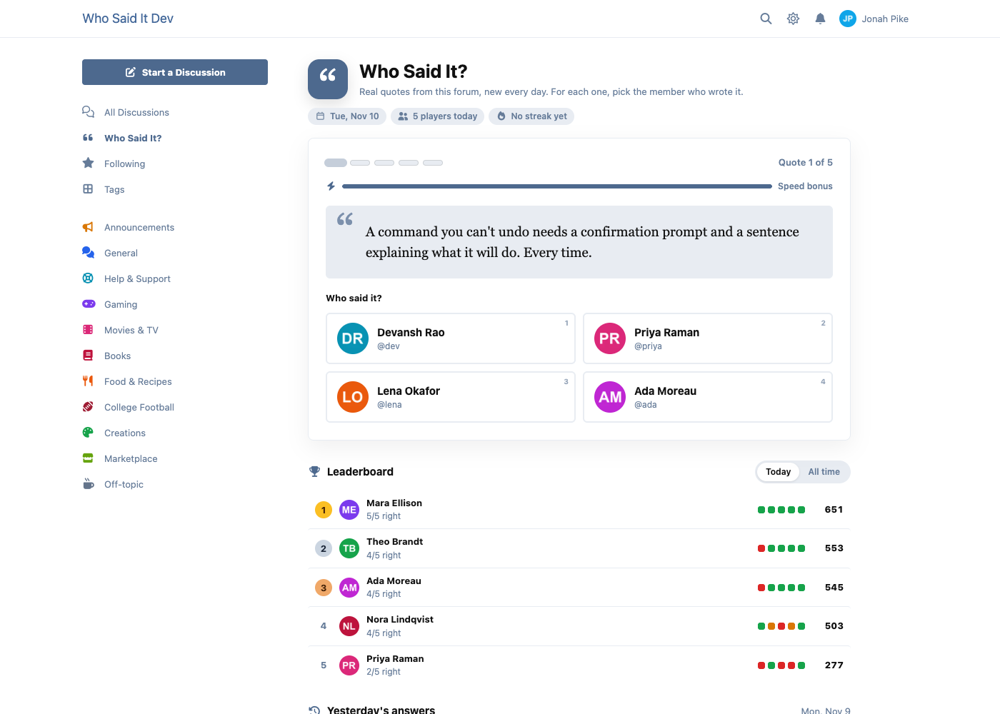
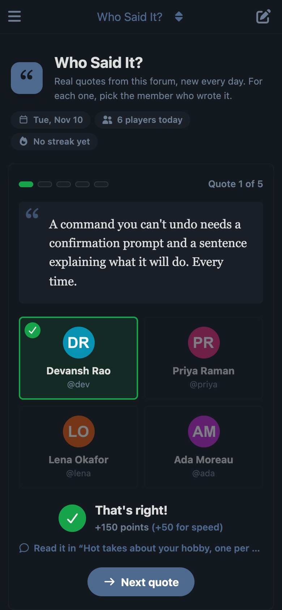
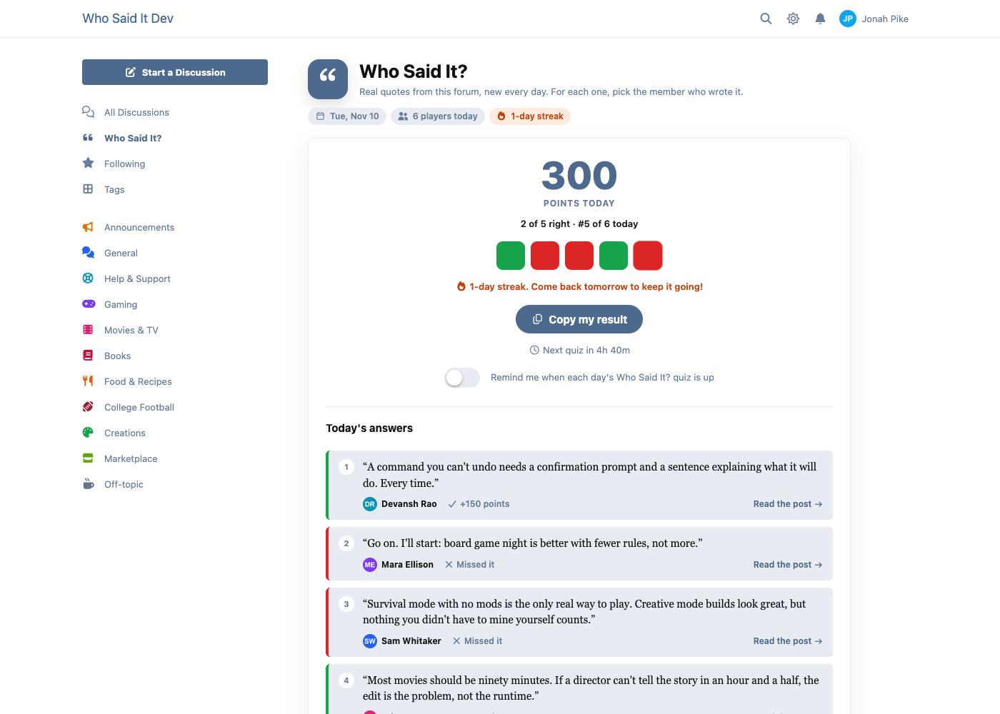
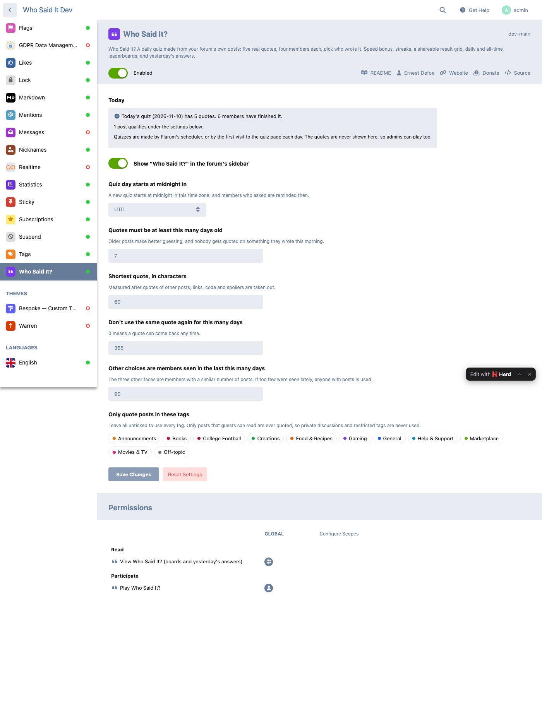

# Who Said It?

A daily quiz made from your forum's own posts. Every day, five real quotes from public posts; for each one, members pick which of four members wrote it. Everyone gets the same five, the answer reveal links to the original post, and tomorrow there's a new set.



## What members get

- **Five quotes a day**, one at a time, with four faces each. 100 points for the right member, plus up to 50 for answering fast. The clock is kept on the server: it starts when the quote appears and a reload doesn't reset it.
- **The reveal**: who said it, the points, and a link to the post in its discussion.
- **A result to share**: a grid of squares (🟩 right and quick, 🟨 right, 🟥 wrong) with the score and streak, copied to the clipboard in one tap.
- **A daily streak**, a **daily leaderboard** and an **all-time** one.
- **Yesterday's answers** for everyone, with how many got each one right.
- **A "today's quiz" card** in the sidebar that fills in as they play, also as a Bespoke widget and a fof/forum-widgets-core widget.
- **A reminder** when each day's quiz is up, if they turn it on (on the quiz page or in their settings).
- **An opt-out**: "Let Who Said It? quote my posts" in their privacy settings. Opted-out members are never quoted and never shown as a choice.
- Keys 1 to 4 pick an answer, Enter goes on. Works in dark mode, with themes and on phones.





## How quotes are picked

Once a day (Flarum's scheduler, or the first visit to the page if the scheduler isn't running), the extension picks five quotes from five different members:

- only from posts **a guest can read**: never private discussions, restricted tags, Byobu conversations, unapproved or hidden posts;
- at least N days old (7 by default) and long enough once cleaned up;
- cleaned to the author's own words: quotes of other posts, links, mentions, code, images and spoilers are taken out, and the author's own name is blanked;
- not used again within a window (365 days by default), and only from tags you choose (all by default).

The three other choices are active members with a similar number of posts. If a quoted post later becomes private or is removed, the quote is withdrawn.

**Answers never reach the browser before the member answers.** A quote arrives as its words and four faces only; the author and the post come back from the server after the answer is checked there. The tests prove it.

## Settings



- The time zone the quiz day starts in (UTC by default)
- How old a quote must be, its shortest length, the repeat window
- How recently the other choices must have been seen
- Which tags quotes may come from
- Never quote members of these groups (bots, feed importers, staff…): they're never quoted and never shown as a choice
- Show the link in the sidebar
- Permissions: view (boards and yesterday's answers; guests by default) and play (members by default)

The admin page shows whether today's quiz is made, how many members finished it, and how many posts qualify under your settings, with a button to make today's quiz now. It never shows the quotes, so admins can play too.

## Known limit

Quotes come only from posts a guest can read. On a forum that guests can't read at all (members only), there is nothing to quote, so no quiz is made.

## Install

```sh
composer require ernestdefoe/who-said-it
php flarum migrate
php flarum cache:clear
```

Flarum's scheduler should be running for the daily reminders (the quiz itself is also made on the first visit of the day).

## Update

```sh
composer update ernestdefoe/who-said-it
php flarum migrate
php flarum cache:clear
```

## Light on your forum

About 4 KB of script and 3 KB of styles (gzipped) on every page; the quiz page itself loads only when someone opens it. The sidebar card is drawn from the forum payload: one small query for a signed-in member, none for guests.

## Links

- [Packagist](https://packagist.org/packages/ernestdefoe/who-said-it)
- [GitHub](https://github.com/ernestdefoe/who-said-it)
- [Support](https://ernestdefoe.online)

MIT licensed. ☕ If you like it, [buy me a coffee](https://buymeacoffee.com/ernestdefoe).
